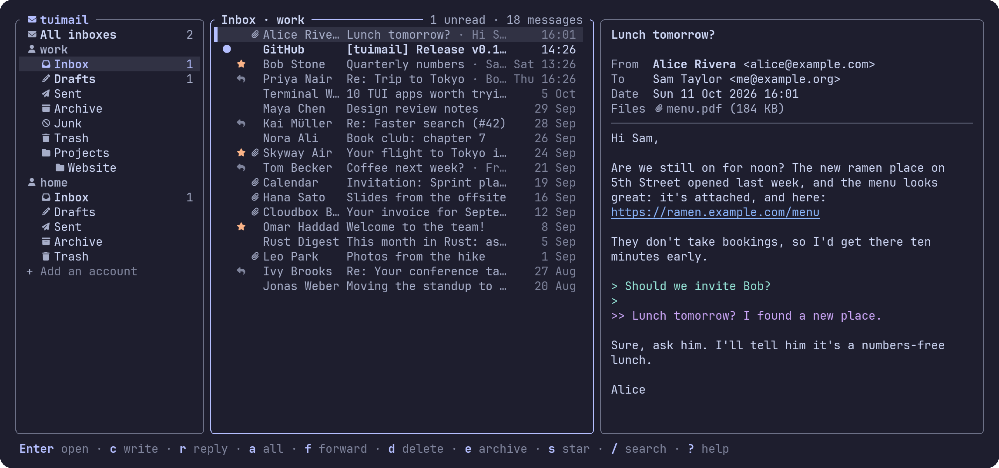

<div align="center">

# tuimail

**Your mail, at the speed of your keyboard.**

A terminal email client (TUI): IMAP and POP3 to read, SMTP to send, several accounts side by side.<br>
Arrow keys or vim keys. Passwords in your system's keychain. Nothing loaded from the internet when you read.

[](https://github.com/erictran308/tuimail/releases/latest)
[](https://crates.io/crates/tuimail)
[](LICENSE)
[](https://www.rust-lang.org)

**[Get started](#get-started)** · **[Keys](#keys)** · **[Accounts](#accounts)** · **[Settings](#settings)** · **[AI agents](#ai-agents-mcp)** · **[Privacy](#privacy-and-security)**



<sub>The demo's made-up mail: <code>tuimail --demo</code></sub>

</div>

---

## Why tuimail

- **IMAP, POP3 and SMTP.** IMAP accounts keep mail on the server, in its folders; POP3 accounts download the inbox and keep Sent, Drafts, Archive and Trash on your computer. Both send through SMTP, with TLS or STARTTLS.
- **New mail at once.** Where the server can (IMAP IDLE), new mail shows the moment it arrives, with a notification through your terminal. Elsewhere tuimail checks every few minutes, and `R` checks now.
- **Several accounts.** Each in the sidebar with its folders, and **All inboxes** together at the top. Write from any of them (`←` `→` on From).
- **Arrows or vim, your choice.** `←↓↑→` and `h j k l` both move, `Enter` opens, `gg` / `G`, `Ctrl-d` / `Ctrl-u`. `?` lists every key, and `O` opens the settings.
- **Reading made calm.** HTML mail is shown as text (bold, italics, links numbered), with nothing it points to fetched: no tracking pixels, no "read" receipts by image. Quotes are colored by depth. `H` shows the plain-text part instead, `o` lists the links, `A` the attachments.
- **Writing in place, or in your editor.** To, Cc, Bcc and Subject with addresses completed from people you've written to or heard from; the text in place, or `Ctrl-e` for `$EDITOR`. Drop a file on the window to attach it. Replies quote, forwards carry the attachments, drafts go to Drafts and open again where you left them.
- **Quick to tidy.** `d` deletes (to Trash), `e` archives, `!` marks junk, `m` moves anywhere, `s` stars, `u` marks read or unread, `t` tags. `Space` marks several messages for any of these at once, and `z` undoes the last of them (`Z` lists them, to undo any). `U` unsubscribes from a mailing list.
- **Conversations.** Replies sit under what they answer, the conversation with the newest message first, so a thread reads top to bottom. They're worked out from the messages themselves, the same for every server and POP3; turn them off in the settings (`O`) for a plain newest-first list.
- **Tags.** Put `work`, `receipts` or any word on a message with `t`. IMAP accounts keep them on the server as keywords, spelled the way Thunderbird spells its tags, so the two show each other's; POP3 accounts keep them on your computer. (Gmail keeps them too, but its website shows only its labels.)
- **Search.** `/` finds mail by sender, recipients, subject or text: at once in what's on your computer, then on the server, which searches whole messages. `tag:work` finds what's tagged.
- **AI agents, on your terms.** Claude Code, Claude Desktop, Cursor or any MCP client can read and sort your mail through `tuimail mcp`: mark, star, tag, move, mark spam, move to Trash. Each change asks you first (unless you say not to), shows on the screen and undoes with `z`. Agents can't delete anything for good, send, or open links.
- **Works offline.** Headers and the messages you've opened are kept in a local cache, so the list and what you've read are there without a connection.
- **Set up in a minute.** Type your address and password: the servers fill in for Gmail, iCloud, Outlook, Yahoo, Fastmail, Proton (through its Bridge), Zoho, GMX, WEB.DE, Yandex, Mail.ru, Posteo, mailbox.org and more, or are guessed for others. tuimail logs in to check before saving.
- **Make it yours.** Catppuccin, Tokyo Night, Dracula, Gruvbox, Nord and Rosé Pine themes (picked in the settings, `O`), and Nerd Font icons where your terminal has them.
- **Private by design.** No account with anyone but your mail provider, no telemetry, no servers in between. Your mail, accounts and settings stay in one folder on your computer, readable only by you.

## Get started

**1. Install tuimail.** If you have Rust and [cargo-binstall](https://github.com/cargo-bins/cargo-binstall), that's one command, on any system:

```sh
cargo binstall tuimail
```

Otherwise, on macOS or Linux, paste this into a terminal. It puts `tuimail` in `~/.local/bin`:

```sh
mkdir -p ~/.local/bin
curl -fsSL https://github.com/erictran308/tuimail/releases/latest/download/tuimail-aarch64-apple-darwin.tar.gz | tar xz -C ~/.local/bin tuimail
```

Swap the file name for your computer's:

| Computer | File |
| --- | --- |
| Mac with Apple silicon (M1 or later) | [`tuimail-aarch64-apple-darwin.tar.gz`](https://github.com/erictran308/tuimail/releases/latest/download/tuimail-aarch64-apple-darwin.tar.gz) |
| Mac with Intel | [`tuimail-x86_64-apple-darwin.tar.gz`](https://github.com/erictran308/tuimail/releases/latest/download/tuimail-x86_64-apple-darwin.tar.gz) |
| Linux, x86_64 | [`tuimail-x86_64-unknown-linux-gnu.tar.gz`](https://github.com/erictran308/tuimail/releases/latest/download/tuimail-x86_64-unknown-linux-gnu.tar.gz) |
| Linux, ARM64 | [`tuimail-aarch64-unknown-linux-gnu.tar.gz`](https://github.com/erictran308/tuimail/releases/latest/download/tuimail-aarch64-unknown-linux-gnu.tar.gz) |
| Windows, x86_64 | [`tuimail-x86_64-pc-windows-msvc.zip`](https://github.com/erictran308/tuimail/releases/latest/download/tuimail-x86_64-pc-windows-msvc.zip) |
| Windows, ARM64 | [`tuimail-aarch64-pc-windows-msvc.zip`](https://github.com/erictran308/tuimail/releases/latest/download/tuimail-aarch64-pc-windows-msvc.zip) |

- **Windows:** download the `.zip`, unzip it, and run `tuimail.exe` from Windows Terminal.
- **Linux:** needs glibc 2.35 or newer: Ubuntu 22.04, Debian 12, Fedora 36, RHEL 9 or later.
- **macOS:** if you downloaded the file in a browser instead, macOS blocks the app. Run `xattr -d com.apple.quarantine tuimail` once to allow it.

If `tuimail` isn't found afterwards, add `~/.local/bin` to your `PATH`. Each file comes with a signed record of the commit it was built from; to check one, run `gh attestation verify <file> --repo erictran308/tuimail --signer-workflow erictran308/tuimail/.github/workflows/release.yml`.

**Or build it from source** (Rust 1.90 or newer, and a C compiler for SQLite):

```sh
cargo install tuimail --locked
```

**2. Run it.**

```sh
tuimail
```

The first start asks for an account: your address and password (for Gmail, iCloud, Yahoo and others, an **app password**: see [App passwords](#app-passwords)). The servers fill in; `Ctrl-s` logs in to check them and saves the account, with the password in your system's keychain.

To look around first, `tuimail --demo` shows made-up accounts and mail, connecting nowhere and sending nothing.

### Check your setup

```sh
tuimail --check
```

It says where your data folder is, whether a keychain is there for passwords, and each account it found: its servers, security and where its password comes from. An account it can't use, or a line in `accounts.toml` it doesn't understand, shows up as a warning.

## Keys

The status bar shows the keys for where you are, and `?` lists them all. `Tab` there goes to the settings.

| Key | Action |
| --- | --- |
| `←↓↑→` / `h j k l` | Move; `Enter`, `→` or `l` opens |
| `Tab` | Folders → messages → the message |
| `gg` / `G`, `Ctrl-u` / `Ctrl-d` | First / last, half a page |
| `c` | Write a message |
| `r` / `a` / `f` | Reply / reply to all / forward |
| `d` | Delete: to Trash; from Trash, for good (asking first) |
| `e` / `!` / `m` | Archive / junk / move to a folder |
| `s` / `u` | Star / read or unread |
| `t` | Tag: put a tag on or take it off, or type a new one |
| `z` / `Z` | Undo the last change (a star, read, tag or move) / list the changes, to undo any |
| `Space` / `*` | Mark a message / all of them; the keys above act on the marked |
| `/` | Search; `Esc` ends it |
| `J` / `K` | Reading: the next / previous message |
| `Space` / `b` | Reading: a page down / up |
| `o` / `A` | Reading: the links (`Enter` open, `y` copy) / attachments (`Enter` open, `s` save) |
| `H` | Reading: HTML or plain text |
| `U` | Unsubscribe from a mailing list |
| `R` | Check for mail now |
| `+` / `x` / `P` | Add an account / remove it (on its row) / type its password, or sign in |
| `?` / `O` | Every key / the settings and themes |
| `q` | Quit |

Writing:

| Key | Action |
| --- | --- |
| `Tab` / `Shift-Tab`, `Enter` | The next / previous field; `Tab` takes a suggested address |
| `Ctrl-s` | Send (asking first, unless turned off) |
| `Ctrl-d` | Save in Drafts and close |
| `Ctrl-o` | Attach a file (or drop it on the window) |
| `Ctrl-e` | Write the text in your editor (`$VISUAL`, `$EDITOR`, or `editor` in the settings) |
| `←` `→` on From | Send from another account |
| `x` on Files | Take a file off |
| `Esc` | Close: `y` keeps it in Drafts, `n` throws it away |

## Accounts

Accounts are kept in `accounts.toml` in [your data folder](#your-data). The setup screen (`+`) writes it; you can also edit it while tuimail isn't running:

```toml
[[account]]
name = "work"                      # what the sidebar calls it
email = "me@example.org"
display_name = "Sam Taylor"        # your name, as recipients see it
protocol = "imap"                  # or "pop3"
host = "imap.example.org"
port = 993                         # if not the usual one
security = "tls"                   # "tls", "starttls", or "none" (this computer only, unencrypted)
smtp_host = "smtp.example.org"
smtp_port = 465
smtp_security = "tls"
password = "keychain"              # "keychain", "ask" (each start) or "command"
signature = "Sam"
```

More keys: `username` and `smtp_username` (if not the address), `password_command` (below), `save_sent` (copy sent mail to Sent; off by default for Gmail and Outlook, which do it themselves), `certificate` (a server certificate to trust, for Proton Mail Bridge or your own server), `leave_on_server` (POP3, on by default), and `sent_folder`, `drafts_folder`, `trash_folder`, `archive_folder`, `junk_folder` when the server doesn't say which folder is which.

`x` on an account's row in the sidebar removes it, its cached mail, and its password from the keychain.

### App passwords

Gmail, iCloud, Yahoo, AOL, Fastmail and others don't take your normal password from mail programs: make an app password in your account's security settings and use that. For Gmail: [myaccount.google.com/apppasswords](https://myaccount.google.com/apppasswords) (it needs 2-Step Verification on).

### Passwords from a command

To keep the password in a password manager instead of the keychain:

```toml
password = "command"
password_command = ["/opt/homebrew/bin/pass", "show", "mail/work"]
```

The program is given by its full path and run without a shell; tuimail uses the first line it prints. It runs once at start with your terminal, so it can ask you to unlock something.

### Signing in with Microsoft or Google (OAuth2)

Outlook.com takes only OAuth2, Microsoft 365 is moving to it, and Gmail takes it as well as app passwords. tuimail signs in itself: add the account with `+` and leave the password empty, and `Ctrl-s` opens your browser on Microsoft's or Google's sign-in page. Once you've signed in there, the browser comes back to tuimail (on this computer only), and tuimail keeps the sign-in in your keychain: a token that lasts, never your password. If the sign-in is taken back (your password changed, the app was removed from your account), tuimail says so, and `P` on the account's row signs in again.

**An app to sign in as.** Microsoft and Google sign people in only for apps registered with them. Until tuimail has registrations of its own, register one for yourself (free, about ten minutes) and name it in `accounts.toml`:

- **Microsoft** (Outlook.com, Hotmail, Microsoft 365): at [entra.microsoft.com](https://entra.microsoft.com), **App registrations** → **New registration**. Name it, pick **Accounts in any organizational directory and personal Microsoft accounts**, and as the redirect URI choose **Public client/native (mobile & desktop)** with `http://localhost`. Copy its **Application (client) ID**.
- **Google** (Gmail): at [console.cloud.google.com](https://console.cloud.google.com), make a project and turn on the **Gmail API**. In **Google Auth Platform**, set up the consent screen (External), add the scope `https://mail.google.com/`, and either add yourself as a test user (then you sign in again every 7 days) or publish the app. Then **Clients** → **Create client** → **Desktop app**, and copy its client ID and secret (a desktop app's "secret" isn't one: Google says so).

```toml
[[account]]
email = "me@outlook.com"
host = "outlook.office365.com"
smtp_host = "smtp-mail.outlook.com"
smtp_port = 587
smtp_security = "starttls"
auth = "oauth2"
oauth_client_id = "your Application (client) ID"
# Google only:
# oauth_client_secret = "the client's secret"
```

Start tuimail, and `P` on the account's row signs in. `tuimail --check` says which accounts sign in.

**Or with a program of yours.** tuimail also logs in with an access token printed by a command, run again for each connection so a short-lived token stays fresh. [oama](https://github.com/pdobsan/oama) and the `mutt_oauth2.py` script both do this:

```toml
auth = "oauth2"
password_command = ["/opt/homebrew/bin/oama", "access", "me@outlook.com"]
host = "outlook.office365.com"
smtp_host = "smtp-mail.outlook.com"
smtp_port = 587
smtp_security = "starttls"
```

### Proton Mail

Run [Proton Mail Bridge](https://proton.me/mail/bridge), use the password it shows for the account, and export its certificate (Bridge → Settings → Export TLS certificates), then point tuimail at it:

```toml
host = "127.0.0.1"
port = 1143
security = "starttls"
smtp_host = "127.0.0.1"
smtp_port = 1025
smtp_security = "starttls"
certificate = "/Users/you/Documents/bridge/cert.pem"
```

## Settings

`O` (or `?` then `Tab`) opens the settings: the message beside the list, plain text or HTML, marking read, conversations, asking before deleting and before sending, notifications, AI agents, and the theme. `j` / `k` move, `Enter` or `Space` turns one on or off (or picks the theme), and it's saved at once, changing only its own line in `settings.toml` and keeping the rest of the file (but not its comments).

Everything else is in `settings.toml` in [your data folder](#your-data). Every line is optional; changes made by hand take effect the next time tuimail starts:

```toml
theme = "mocha"          # latte, frappe, macchiato, mocha, tokyonight, dracula, gruvbox, nord, rose-pine
icons = "auto"           # auto (Nerd Font icons in Ghostty, kitty and WezTerm), nerd or plain
notifications = "auto"   # auto (what your terminal understands), off, bell, osc9, osc777 or osc99
preview = true           # the open message beside the list, when the window is wide enough
prefer_plain = false     # a message's plain-text part rather than its HTML, when it has both
mark_read = true         # mark a message read once it's shown
threads = true           # group the list in conversations
confirm_delete = false   # ask before moving mail to Trash
confirm_send = true      # ask before sending (a message without a subject always asks)
check_minutes = 5        # how often to check where the server can't say at once, and folders other than the inbox (1 to 1440)
fetch_count = 300        # how many of a folder's newest messages to fetch at first (20 to 5000); older ones as you scroll
sidebar_width = 28       # in columns (16 to 50)

agents = false           # let AI agents read and sort your mail (tuimail mcp), while tuimail is open
confirm_agents = true    # ask before each change an agent makes

# Where `s` saves attachments, if not your Downloads folder:
# downloads = "/Users/you/Mail attachments"
# The editor for Ctrl-e, as a full path with its arguments, if not $VISUAL or $EDITOR:
# editor = ["/usr/bin/vim"]
```

## AI agents (MCP)

`tuimail mcp` is an [MCP](https://modelcontextprotocol.io) server: an AI agent starts it, and it reaches your mail through the tuimail you have open. Nothing is kept in it and nothing goes around tuimail: every request is checked, and every change is made by tuimail as your keys would make it.

**1. Turn it on.** In tuimail, `O`, then **Let AI agents read and sort your mail**. tuimail must be open for agents to reach your mail.

**2. Add it to your agent**, by tuimail's full path (`which tuimail`):

- **Claude Code:** `claude mcp add --scope user tuimail -- /Users/you/.local/bin/tuimail mcp`
- **Claude Desktop** (`claude_desktop_config.json`) or **Cursor** (`~/.cursor/mcp.json`):

  ```json
  { "mcpServers": { "tuimail": { "command": "/Users/you/.local/bin/tuimail", "args": ["mcp"] } } }
  ```

**What agents can do:** list accounts and folders, search what tuimail has on your computer, read a message (its links, wherever they are, shown only by their site), mark read or unread, star, tag, move to a folder of yours, mark spam or not (to Junk and back), move to Trash, and undo their own changes.

**What they can't:** delete anything for good (mail already in Trash stays there, and an account without a Trash folder takes nothing), move mail into Drafts or Sent, see or touch other users' or shared folders, send, reply or forward, open links or unsubscribe, read attachments, make filters, change settings, or touch passwords. There are no tools for these; tuimail refuses them whatever an agent asks.

**You stay in charge:**

- Each change waits for your `y` in tuimail; any other key says no. Once you trust your agent, turn off **Ask before each change an agent makes** in the settings: changes are then made at once, and said on the status line and in a notification.
- Every change is listed with who made it (`Z`), and `z` undoes it as it undoes yours.
- At most 50 messages a call, 300 changes and 100 moves to Trash or Junk an hour, and 200 messages (512 MB) downloaded for agents' reads.
- Turning agents off, in any tuimail window or in `settings.toml`, stops every tuimail answering them.
- The agent is told, in the server's instructions, that what's in mail is from strangers and is never an instruction, and to ask you before changing more than ten messages. tuimail keeps its own rules whether the agent listens or not.

To try it on made-up mail: run `tuimail --demo`, turn agents on there, and add `tuimail mcp --demo` to your agent instead.

What an agent reads goes to its AI provider, as anything else you show it. AI agents reach tuimail on macOS and Linux; Windows isn't supported yet.

## Privacy and security

- **Nothing fetched to read.** HTML is turned into text on your computer; pictures are shown by their description, never downloaded, so senders can't tell when you read their mail.
- **Signing in keeps no password.** With Microsoft or Google, you sign in on their page in your browser; tuimail keeps only the sign-in's token, in your keychain, and gets short-lived ones with it as needed. The browser comes back to tuimail on this computer only, and a sign-in is good only to the tuimail that asked for it (PKCE).
- **Passwords stay out of files.** They're in your system's keychain (macOS Keychain, Windows Credential Manager, the Secret Service on Linux), asked for at each start, or printed by your own command. Never in `accounts.toml`, never on a command line.
- **TLS, checked.** Connections use TLS (or STARTTLS, which must succeed before anything is sent) and your system's trusted certificates. An unencrypted connection is allowed only to a server on your own computer, at its loopback address; on Linux, only if that server runs as you or the system. On a computer shared with other accounts, prefer STARTTLS with `certificate` (as for Proton Mail Bridge): there, any account could answer on a free port.
- **Nothing about your computer in what you send.** Messages go out with a random Message-ID and a UTC date, and tuimail greets SMTP servers as `[127.0.0.1]`, so your computer's name never ends up in mail headers.
- **Text from senders can't take over your terminal.** Control characters, escape sequences and direction-changing characters are taken out of everything shown, copied or notified.
- **Attachments are handled with care.** File names are cleaned (no folders, no hidden extensions), files never overwrite one another, they're marked as downloaded from the internet, and only pictures, sound, video, PDF and plain text open without asking (Office files, archives, CSV and the rest ask first). Web links open only through your browser, and only `http` and `https`; the link list shows where each one really goes, with look-alike letters spelled out (`xn--`). `mailto` links and `U`'s addresses open here, as a message to write; `U`'s web page is shown before it opens.
- **Pastes stay text.** A paste that arrives as keystrokes (as it always does on Windows) is never taken for commands, and a question that waits for `y` ignores one typed too soon.
- **Local data is yours alone.** The data folder is made readable only by you; the cache (`tuimail.db`) overwrites what's deleted.

To report a problem, see [SECURITY.md](SECURITY.md).

## Your data

Everything is in one folder on your machine (`tuimail --help` prints its path):

| OS | Location |
| --- | --- |
| macOS | `~/Library/Application Support/tuimail` |
| Linux | `~/.local/share/tuimail` |
| Windows | `%LOCALAPPDATA%\tuimail` |

It holds `accounts.toml`, `settings.toml`, and `tuimail.db`: the cache of your folders, headers and the messages you've opened, POP3 accounts' mail, and the addresses used for completing To, Cc and Bcc. Attachments you open go to its `opened/` folder. Passwords aren't in it: they're in your system's keychain. Deleting the folder starts tuimail afresh; remove the accounts with `x` first to take their passwords out of the keychain too.

| Variable | Use |
| --- | --- |
| `TM_DATA_DIR` | Keep the data folder somewhere else (a full path) |
| `TM_ICONS` | Which icons: `auto`, `nerd` or `plain` |

## Development

```sh
cargo test                       # offline tests
cargo clippy --all-targets
TM_DATA_DIR=$HOME/tm-test cargo run   # a separate data folder (a full path) for trying things
cargo run -- --demo              # made-up accounts and mail, nothing connects or is sent
```

The tests against a real server run against [GreenMail](https://greenmail-mail-test.github.io/greenmail/) in Docker (IMAP, POP3 and SMTP over TLS); the commands are at the top of `src/live.rs`.

Only development builds read a `.env`, and only from the source folder, never the folder they're started from, and only its `TM_*` lines: an installed tuimail ignores it, so a `.env` in a folder you cloned can't change where your mail is kept.

## Built with

- [ratatui](https://ratatui.rs), [crossterm](https://github.com/crossterm-rs/crossterm) and [ratatui-textarea](https://github.com/ratatui/ratatui-textarea)
- [async-imap](https://github.com/async-email/async-imap) for IMAP; POP3 and SMTP written here
- [mail-parser](https://github.com/stalwartlabs/mail-parser) and [mail-builder](https://github.com/stalwartlabs/mail-builder) from Stalwart, and [html2text](https://github.com/jugglerchris/rust-html2text)
- [rustls](https://github.com/rustls/rustls) with [rustls-platform-verifier](https://github.com/rustls/rustls-platform-verifier), [rusqlite](https://github.com/rusqlite/rusqlite), and [keyring-core](https://github.com/open-source-cooperative/keyring-core) for the keychain
- The same UI groundwork, themes and safety rules as [tuigram](https://github.com/erictran308/tuigram), [tuitube](https://github.com/erictran308/tuitube) and [tuimeta](https://github.com/erictran308/tuimeta)
- Colors from [Catppuccin](https://catppuccin.com), [Tokyo Night](https://github.com/folke/tokyonight.nvim), [Dracula](https://draculatheme.com), [Gruvbox](https://github.com/morhetz/gruvbox), [Nord](https://www.nordtheme.com) and [Rosé Pine](https://rosepinetheme.com)

## License

[MIT](LICENSE)
